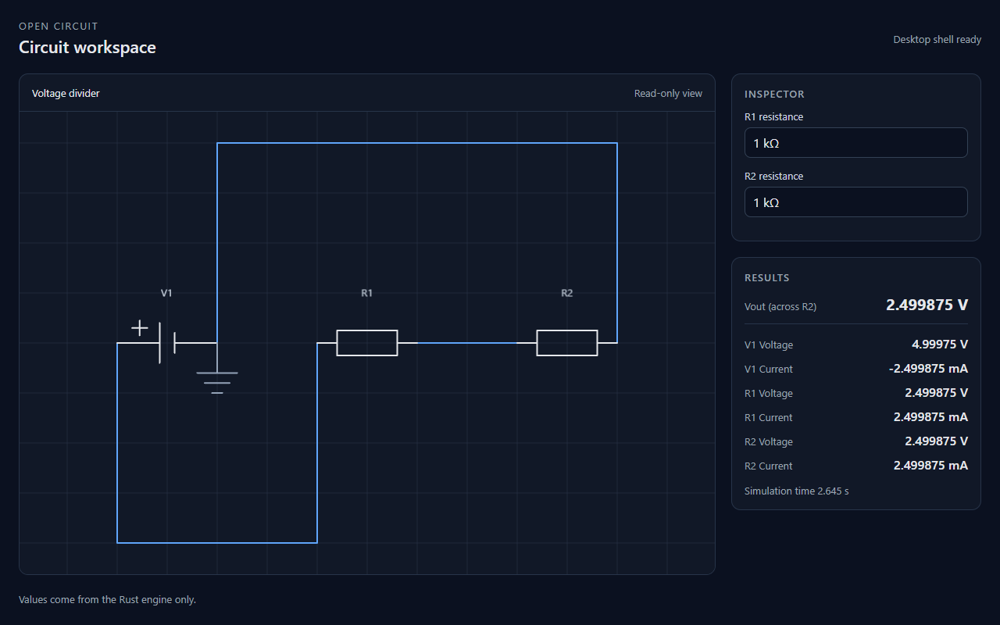
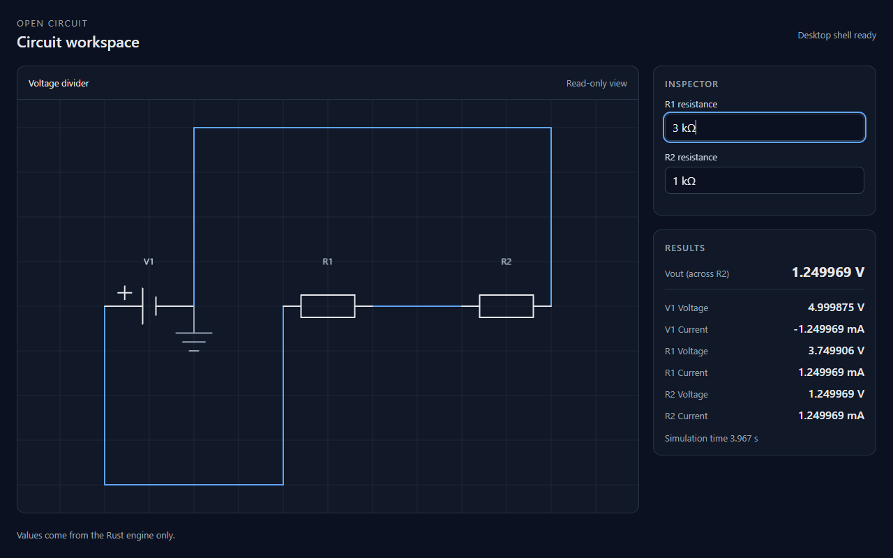

# Stage 1 acceptance record: the end-to-end divider

**Issue:** #10, under the Stage 1 epic #1.
**Recorded:** 2026-10-24.

This is the record the issue asks for: both values, the changed parameter, the operating
system and versions, the continuous-integration results, and what was and was not verified.
The numbers come from the real Rust engine running in the real desktop application.

## Environment

| | |
|---|---|
| Operating system | Windows 11 Pro 10.0.26100 (build 26100), 64-bit |
| Hardware | Intel Core i5-12400F, 15.8 GB RAM |
| WebView | Microsoft Edge WebView2 155.0.4283.62 |
| Application | Tauri 2.12.5 (`tauri` crate), `@tauri-apps/api` 2.12.4, release build |
| Toolchain | Rust 1.99.1, Node.js 24.19.0, pnpm 12.3.4 (the versions pinned in the repository) |

## The two values

Fixture: `Vs = 5 V`, `Rs = 0.1 Ω`, `R1 = R2 = 1000 Ω`. Vout is the voltage across R2.

| State | Vout shown | Exact | Within the 1 µV tolerance |
|---|---|---|---|
| `R1 = 1 kΩ`, as launched | `2.499875 V` | `2.499875006 V` | yes |
| `R1` changed to `3k` in the inspector | `1.249969 V` | `1.249968751 V` | yes |
| `R1` changed back to `1k` | `2.499875 V` | `2.499875006 V` | yes |

At `R1 = 3 kΩ` the other readings were `R1` voltage `3.749906 V`, source terminal voltage
`4.999875 V`, and a series current of `1.249969 mA` with the source current at
`-1.249969 mA`: the source discharges, so its current leaves `pin1`, as the contract says.
Every displayed number is rounded to seven significant digits (contract section 6.1); the
unrounded values are checked against the tolerances in the automated tests below.

## Behaviour checked in the running application

The window was driven through a WebView2 remote-debugging port, enabled only in a separate
local build outside the repository. The UI was read and edited through its own DOM.

- **Rapid edits.** `2k`, `3k`, and `4k` were entered 40 ms apart. Once they settled, Vout was
  `999.98 mV`, exactly the value for `R1 = 4 kΩ`, so no stale result was applied. The
  simulation clock kept advancing throughout (5.248 s before, 6.891 s after), so the UI
  stayed responsive.
- **Invalid input.** `0` in the R2 field was refused in the UI with "That value is outside
  the allowed range." Nothing was sent to the engine and the readings were unchanged.
  Sent straight to the engine, the same value is refused with an `InvalidParameter`
  diagnostic and the previous readings stay (checked by the automated test below).
- **Live frames.** The clock ran at real time and the UI updated about 60 times per second
  (details in `docs/adr/0001-binary-channel-frames.md`).
- **Closing.** Closing the window ended the application by itself with no process left.
- **Production never shows mock readings.** The footer reads "Values come from the Rust
  engine only." No mock banner appears, and `pnpm bundle:check` proves the production
  bundle does not contain the mock adapter.

## Clean clone

The repository was cloned into an empty directory at commit `e814582` (`main` with the
bridge merged) and run by the README steps only: `pnpm install --frozen-lockfile`, then
`pnpm dev`, with the pinned toolchain already installed. The install took 3.7 s, the first
build of the application took 1 min 1 s, and the window opened with the schematic and the
engine's readings. It then ran for about 15 minutes with the simulation clock at 879 s and
the readings unchanged, and closed cleanly. At that commit the readings had six significant
digits (`2.49988 V`); the seven-digit rule arrives with this change.

## Continuous integration

CI on `main` at `e814582` passed on all three systems:
[run 40129857340](https://github.com/SWOFART/open-circuit/actions/runs/40129857340)
(`windows-latest`, `ubuntu-latest`, `macos-latest`). It builds the Tauri application on each
system but does not open the window, so the window runs above exist for Windows only.
The run for the change that adds this record is linked from its pull request.

## Automated checks for the acceptance criteria

| Criterion | Where it is checked |
|---|---|
| Real engine through Tauri, mock never supplies readings | `src/store/simulation.test.ts` (adapter selection), `scripts/check-production-bundle.mjs` in CI |
| Vout and the 3000 Ω value, restoring the original | `crates/app/tests/bridge_session.rs` and `src/store/endToEnd.test.tsx` |
| Pre-format error within 1 µV and 1 nA; units, directions, IDs | the same two tests, using the unrounded values |
| Displayed rounding keeps the fixture within tolerance | `src/ui/acceptance.test.ts` |
| Invalid input never yields a successful `NaN` | `endToEnd.test.tsx` (engine refusal, a `null` value), `units.test.ts`, `panels.test.tsx` |
| Rapid edits never apply stale frames | `src/store/simulation.test.ts`, `src/store/liveFrames.test.ts` |
| Engine, bridge DTO, binary decode, UI adapter, screen | `bridge_session.rs` records a real session; `endToEnd.test.tsx` replays it |
| Close releases resources | `crates/app/tests/simulation_service.rs`, `src/store/liveFrames.test.ts` |

## Not verified

- **Linux and macOS.** CI builds there, but the window was not run, and the WebKit-based
  webviews were not observed.
- **A human-operated run.** The window was driven and read through its debugging port. A
  person did not type the values, although the screenshots are of the real window.
- **Sign-off.** The seven-digit display rule (contract section 6.1, added by this change)
  needs review by both the Engine and the Application owners. The issue's "agreed
  rounding" is not agreed until they approve this change.
