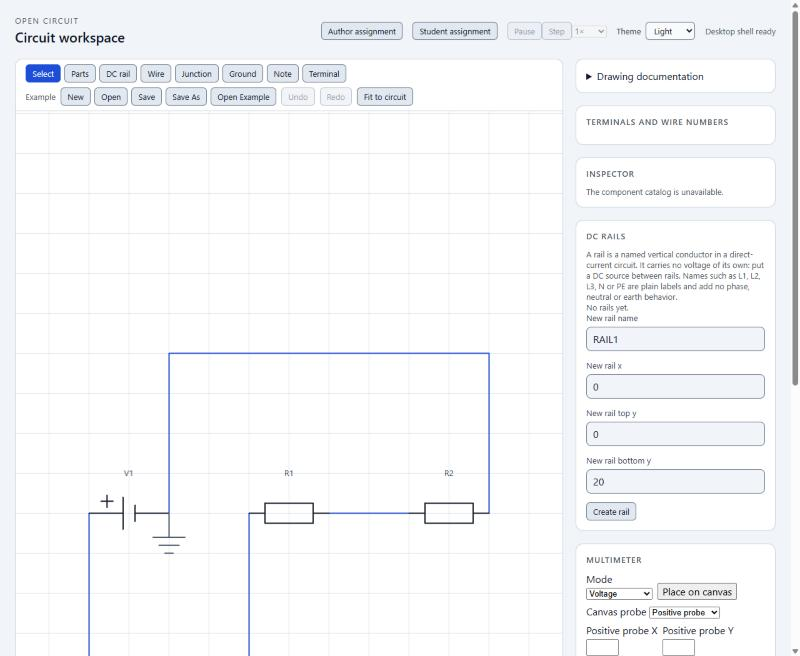
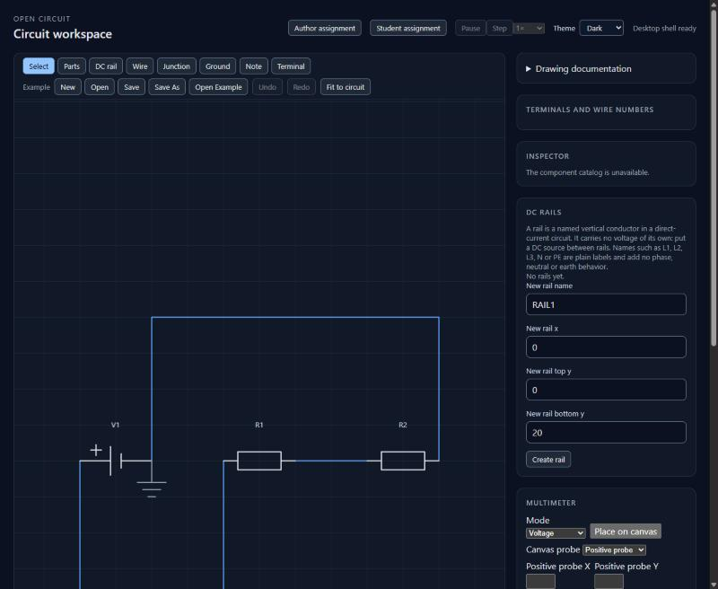

# Stage 16 acceptance: light and dark themes (#229)

Evidence for [docs/contracts/stage-16-editor-improvements.md](../contracts/stage-16-editor-improvements.md)
section 8. The same divider circuit in the two themes, from the web build of the interface
(`vite`, with the mock Engine adapter), 1280 x 1050 window:

| Light | Dark |
| --- | --- |
|  |  |

- **One set of tokens.** `src/theme/tokens.ts` holds the named colors of both themes. The interface
  reads them as CSS custom properties set on the root element (`applyTheme`); the canvas renderer is
  handed the same values (`EditorCore.setTheme`); the oscilloscope traces are `var(--trace-N)`. A test
  (`src/theme/theme.test.ts`) fails the build if a source file other than the tokens and the fixed-color
  drawing exports holds a hex or `rgb()` color, or if the stylesheet uses a custom property no theme defines.
- **Contrast, computed from the tokens** (`src/theme/tokens.test.ts`, both themes): every text token
  against every interface surface and against the colored surface it is used on, at least 4.5:1; control
  borders, state outlines and focus outlines against the surfaces, and the wires, rails, symbols, markers,
  selection, preview and traces against the canvas or plot surface, at least 3:1. Decorative dividers
  (`line`, `line-faint`) and the canvas grid are exempt and only tested to be visible and quieter than a wire.
  The dark theme's control borders were lightened to pass (`#334155` to `#6b7a90`).
- **Preference.** System (default, follows `prefers-color-scheme` live), Light or Dark, in local storage
  under `open-circuit.theme`, never in a project, an assignment, the Engine or the history. An unknown or
  unreadable value is System; storage that refuses leaves the choice to the session.
- **No recompile.** Switching sets properties and redraws the canvas; it touches no document and no run.
  Printing and the cabinet drawing exports keep their own fixed light colors (stage 12).

Not verified: a native-app walkthrough (CI runs no tests, and these screenshots are from the web build), the
System mode following a live change of the operating system's appearance (covered by the resolution logic,
not by an emulated media change), and state-by-color audit of every panel (the new theme control names
its modes in words).
